# Бот продажи рекламы в Telegram-каналах

Telegram-бот, который продаёт рекламу в ваших каналах: показывает покупателю каталог каналов с ценами и статистикой,
принимает рекламный пост, отдаёт его вам на модерацию, принимает оплату (Telegram Stars, [CryptoBot](https://t.me/send?start=r-jtnvb), [xRocket Pay](https://t.me/xrocket?start=i_tZBUn57Wmw), рубли через [FreeKassa](https://freekassa.net/auth/registration?inv=git_ads_channel_bot&input_type=hidden))
и **сам публикует пост** в выбранных каналах в оплаченное время. К боту прилагается веб-панель администратора.

- Python 3.12, [aiogram 3](https://docs.aiogram.dev/), aiohttp, SQLite — без внешней БД и очередей.
- Один процесс: бот + фоновые задачи + веб-панель. Запуск — одной командой через Docker.
- Интерфейс покупателя на русском и английском, админка — на русском.
- Лицензия [MIT](LICENSE).

<table>
  <tr>
    <td align="center">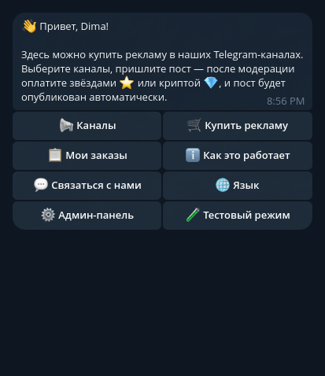</td>
    <td align="center">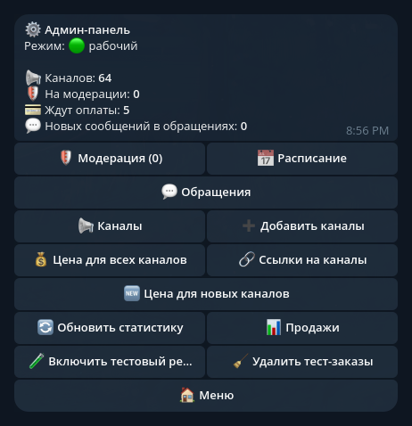</td>
  </tr>
  <tr>
    <td align="center"><sub>Главное меню покупателя</sub></td>
    <td align="center"><sub>Админ-панель в боте</sub></td>
  </tr>
</table>

**Веб-панель администратора** (на скриншотах — демо-данные, нажмите, чтобы открыть в полном размере):

<table>
  <tr>
    <td align="center" valign="top"><a href="docs/screenshots/panel-overview.png">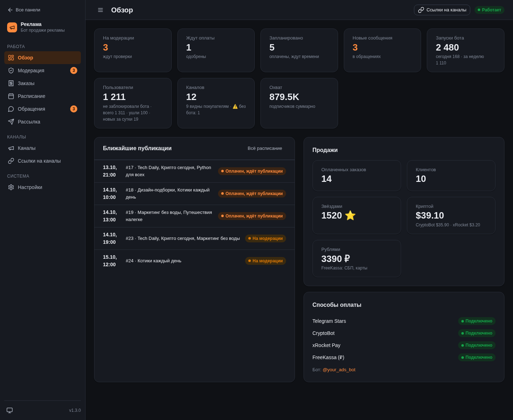</a><br><sub>Обзор</sub></td>
    <td align="center" valign="top"><a href="docs/screenshots/panel-moderation.png">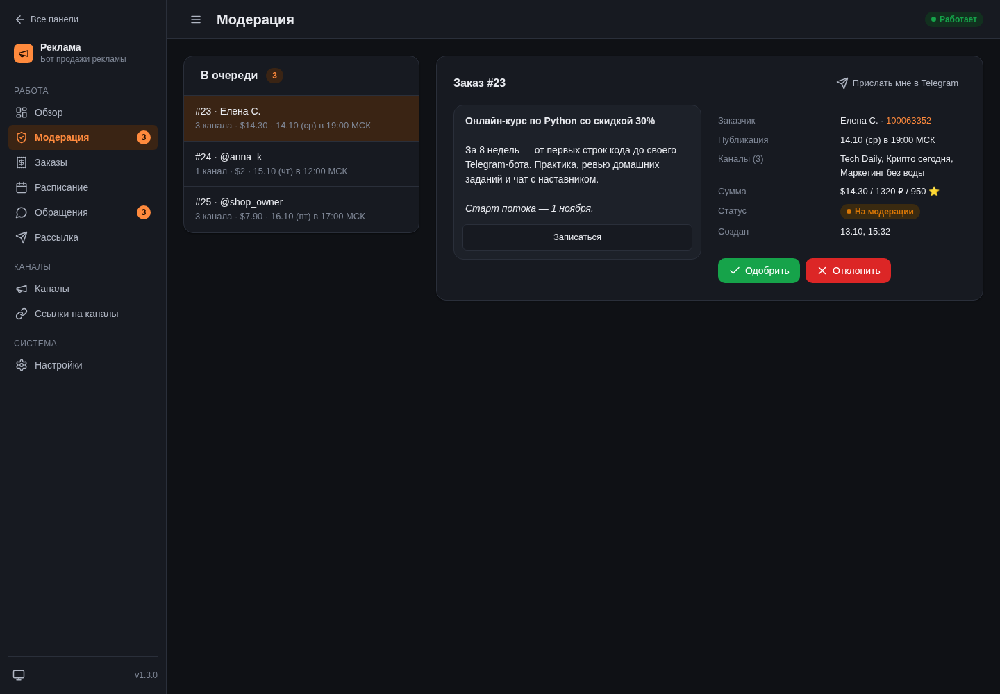</a><br><sub>Модерация</sub></td>
    <td align="center" valign="top"><a href="docs/screenshots/panel-orders.png">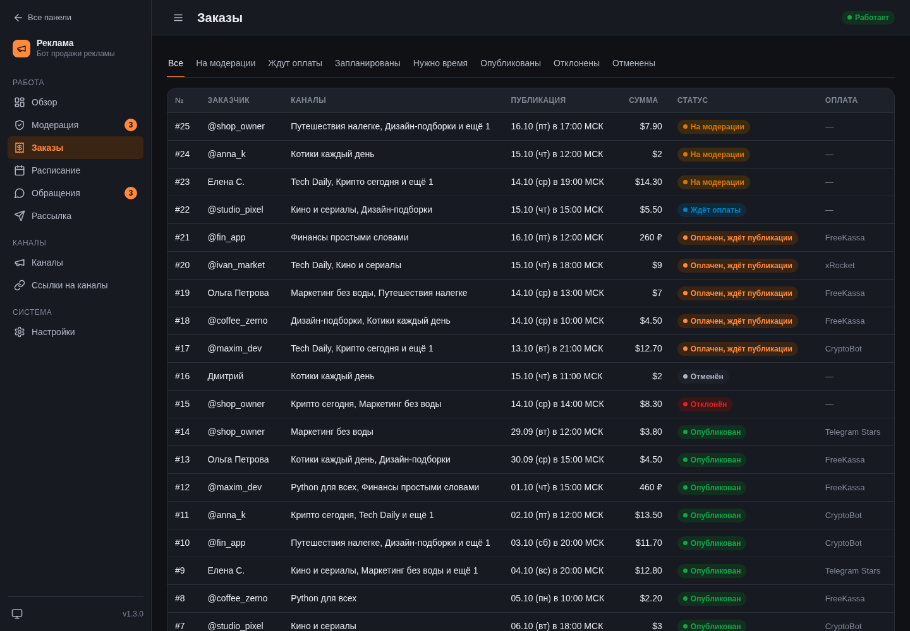</a><br><sub>Заказы</sub></td>
  </tr>
  <tr>
    <td align="center" valign="top"><a href="docs/screenshots/panel-schedule.png">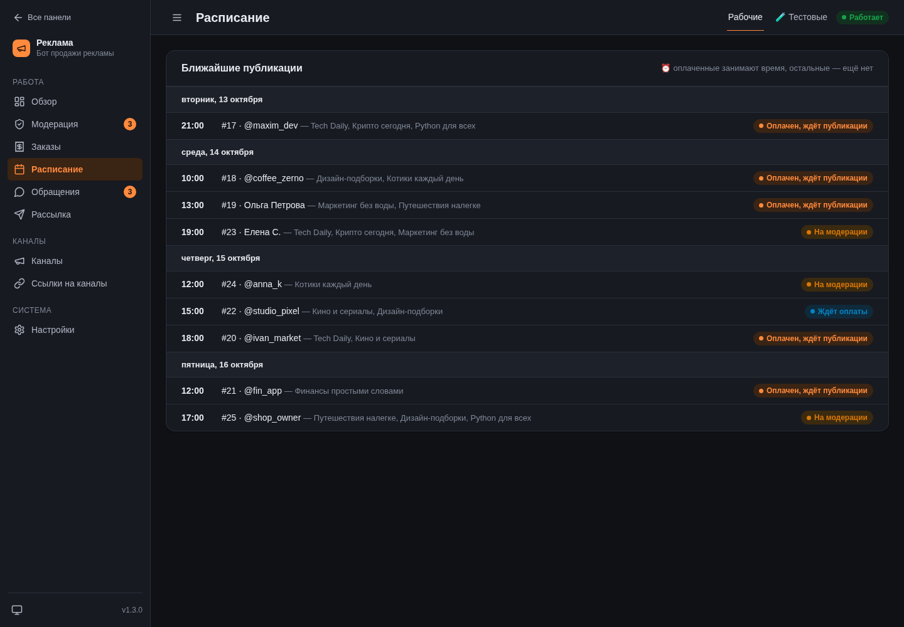</a><br><sub>Расписание</sub></td>
    <td align="center" valign="top"><a href="docs/screenshots/panel-support.png">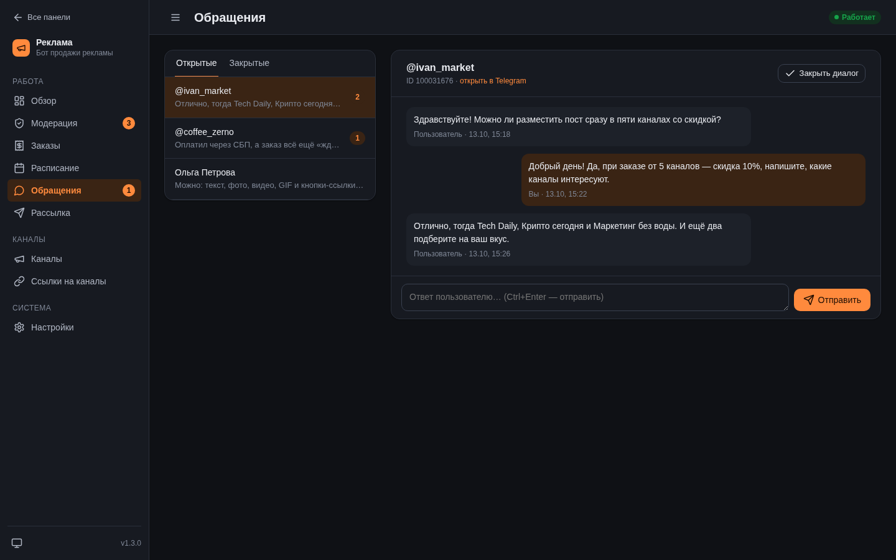</a><br><sub>Обращения</sub></td>
    <td align="center" valign="top"><a href="docs/screenshots/panel-broadcast.png">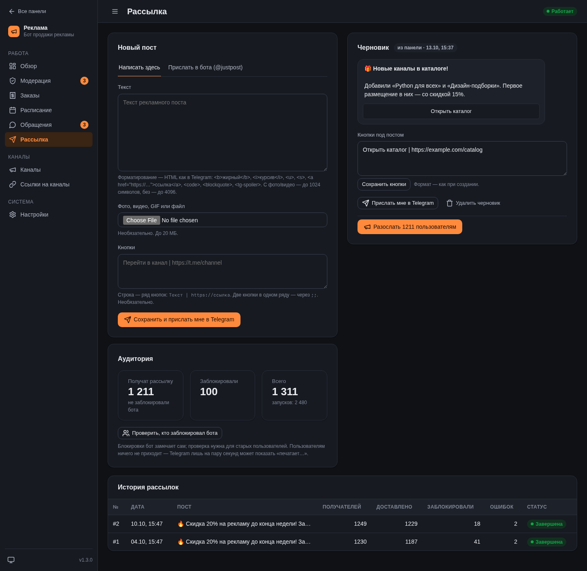</a><br><sub>Рассылка</sub></td>
  </tr>
  <tr>
    <td align="center" valign="top"><a href="docs/screenshots/panel-channels.png">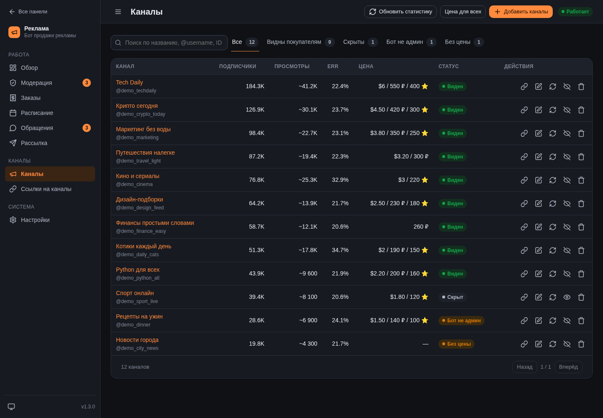</a><br><sub>Каналы</sub></td>
    <td align="center" valign="top"><a href="docs/screenshots/panel-links.png">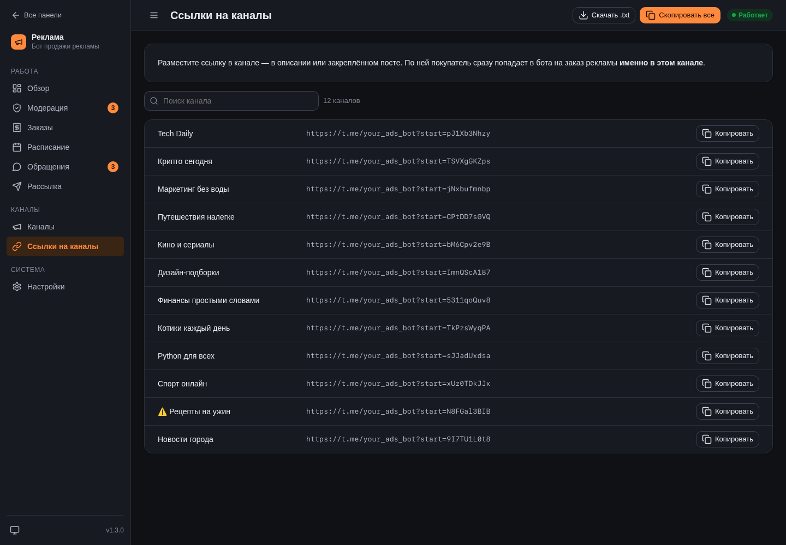</a><br><sub>Ссылки на каналы</sub></td>
    <td align="center" valign="top"><a href="docs/screenshots/panel-settings.png">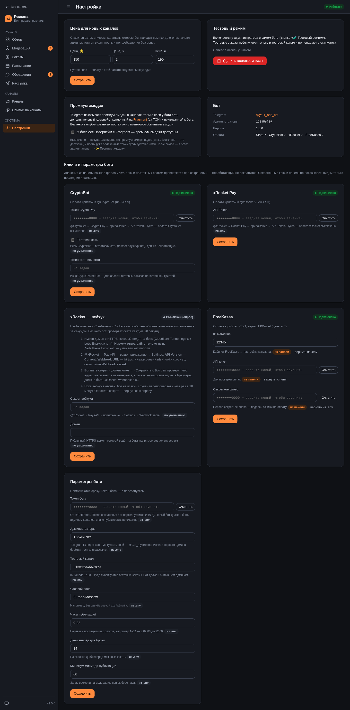</a><br><sub>Настройки: цены, премиум-эмодзи, ключи оплаты, параметры бота</sub></td>
  </tr>
</table>

## Содержание

1. [Возможности](#возможности)
2. [Как это работает](#как-это-работает)
3. [Что понадобится](#что-понадобится)
4. [Установка на VPS — пошагово](#установка-на-vps--пошагово)
5. [Доступ к веб-панели](#доступ-к-веб-панели)
6. [Первая настройка после запуска](#первая-настройка-после-запуска)
7. [Обновление, бэкап, перенос](#обновление-бэкап-перенос)
8. [Переменные окружения](#переменные-окружения)
9. [Работа с ботом и панелью](#работа-с-ботом-и-панелью)
10. [Частые проблемы](#частые-проблемы)
11. [Локальный запуск для разработки](#локальный-запуск-для-разработки)
12. [Структура проекта](#структура-проекта)
13. [Поддержка](#поддержка)

---

## Возможности

**Покупатель (в боте):**
- каталог каналов: название, подписчики, средние просмотры, ERR, цена в $, ₽ и ⭐; страницы по 10 каналов;
- выбор нескольких каналов сразу, даты и часа публикации — видно, где время свободно (✅), частично занято (🟡)
  или занято (❌); при конфликте бот предложит ближайшее общее свободное время;
- пост готовится в [@justpost](https://t.me/justpost) (текст, медиа, кнопки) и присылается боту;
- оплата: Telegram Stars, [CryptoBot](https://t.me/send?start=r-jtnvb), [xRocket Pay](https://t.me/xrocket?start=i_tZBUn57Wmw),
  рубли через [FreeKassa](https://freekassa.net/auth/registration?inv=git_ads_channel_bot&input_type=hidden) (СБП, банковские карты, FKWallet). Покупатель видит только те способы,
  для валют которых у канала задана цена;
- «Мои заказы», перенос времени, отмена, обратная связь с администратором, выбор языка (RU/EN);
- персональная ссылка на каждый канал (`t.me/<ваш_бот>?start=<токен>`) — по ней покупатель сразу попадает на заказ
  рекламы именно в этом канале. Ссылку размещают в описании или закрепе канала.

**Администратор (в боте и в веб-панели):**
- модерация постов: одобрить (покупателю уходит счёт) или отклонить с причиной;
- каналы находятся **автоматически**: назначьте бота админом канала — он сам добавит канал и поставит цену по умолчанию;
- название, подписчики и средние просмотры обновляются раз в час (просмотры — из публичной ленты `t.me/s/<канал>`,
  для приватных каналов задаются вручную);
- цены по отдельности или для всех каналов сразу, скрытие каналов;
- расписание публикаций, история заказов, продажи по способам оплаты;
- обращения покупателей с ответами прямо из панели;
- рассылка рекламного поста всем пользователям бота (с кнопками, медиа, прогрессом и остановкой);
- тестовый режим: заказы проходят весь путь, но публикуются только в тестовый канал, а оплата — тестовая.

## Как это работает

```
Покупатель                         Бот                                    Администратор
──────────                         ───                                    ─────────────
выбирает каналы, дату и час  ──►
присылает пост (@justpost)   ──►   заказ «на модерации»            ──►    одобряет / отклоняет
                             ◄──   счёт (Stars / CryptoBot / xRocket / FreeKassa)
оплачивает                   ──►   время бронируется в момент оплаты
                                   в нужный час публикует пост в каналах
                             ◄──   уведомление со ссылками на посты
```

Статусы заказа: `moderation` → `approved` (ждёт оплаты) → `scheduled` (оплачен, время забронировано) → `paid`
(публикуется) → `published`. Ветки: `rejected`, `cancelled`, `need_time` (оплатили, но время успел занять другой —
покупатель выбирает новое без повторной модерации).

Правила расписания:
- в одном канале — одна реклама в час;
- время **не занимается**, пока заказ на модерации или ждёт оплаты; оно бронируется только в момент оплаты;
- публиковать можно только в рабочие часы (`WORK_HOURS`), не раньше чем через `MIN_LEAD_MINUTES` минут
  и не дальше чем на `BOOKING_DAYS` дней вперёд.

Фоновые задачи внутри процесса: проверка крипто-оплат (каждые 20 с), публикация по расписанию (каждые 30 с),
обновление данных каналов (раз в час), сводка админу о найденных каналах (раз в минуту), рассылка (только пока идёт).

## Что понадобится

| Что | Зачем | Где взять |
|---|---|---|
| VPS-сервер с Linux (Ubuntu 22.04/24.04 или Debian 12) | здесь будет круглосуточно работать бот | [FirstVDS](https://firstvds.ru/?from=1187253) |
| Токен бота | чтобы бот работал от имени вашего бота | [@BotFather](https://t.me/BotFather) |
| Ваш числовой Telegram ID | чтобы бот знал, кто администратор | [@Get_myidrobot](https://t.me/Get_myidrobot) |
| Свои Telegram-каналы | куда бот будет публиковать рекламу | — |
| Токен Crypto Pay *(необязательно)* | приём оплаты в криптовалюте через CryptoBot | [@CryptoBot](https://t.me/send?start=r-jtnvb) |
| Токен xRocket Pay *(необязательно)* | приём оплаты через xRocket | [@xRocket](https://t.me/xrocket?start=i_tZBUn57Wmw) |
| Магазин FreeKassa *(необязательно)* | приём оплаты в рублях: СБП, карты, FKWallet | [FreeKassa](https://freekassa.net/auth/registration?inv=git_ads_channel_bot&input_type=hidden) |
| Домен *(необязательно)* | открыть веб-панель по HTTPS по красивому адресу | любой регистратор доменов |

Оплата звёздами (Telegram Stars) работает без дополнительных токенов. Если не задать токены [CryptoBot](https://t.me/send?start=r-jtnvb), [xRocket](https://t.me/xrocket?start=i_tZBUn57Wmw)
или FreeKassa, соответствующие кнопки оплаты просто не появятся.

**Цены в трёх валютах.** У каждого канала три цены: звёзды (Telegram Stars), доллары (CryptoBot, xRocket) и рубли
(FreeKassa). Любую можно не задавать — тогда оплату в этой валюте покупатель не увидит. Если покупатель выбрал
несколько каналов, способ оплаты доступен, только когда цена в этой валюте есть у всех выбранных каналов.

**Требования к серверу:** 1 vCPU, 1 ГБ RAM (боту хватает ~150 МБ), 10 ГБ диска — подойдёт минимальный тариф [FirstVDS](https://firstvds.ru/?from=1187253). Сервер должен иметь доступ к
`api.telegram.org` — выбирайте расположение, где Telegram не заблокирован.

---

## Установка на VPS — пошагово

### Шаг 1. Создайте бота в @BotFather

1. Откройте [@BotFather](https://t.me/BotFather) и отправьте `/newbot`.
2. Введите имя бота (видно пользователям, например «Реклама в моих каналах»).
3. Введите username — должен заканчиваться на `bot`, например `my_ads_shop_bot`.
4. BotFather пришлёт **токен** вида `1234567890:AAH...`. Сохраните его — это `BOT_TOKEN`.
   Никому его не показывайте: по токену можно управлять ботом.
5. *(По желанию)* оформите бота: `/setuserpic` — аватар, `/setdescription` — текст на стартовом экране,
   `/setabouttext` — описание в профиле.

Список команд бот выставляет сам при запуске, настраивать `/setcommands` не нужно.

### Шаг 2. Узнайте свой Telegram ID

1. Откройте [@Get_myidrobot](https://t.me/Get_myidrobot) и нажмите «Start».
2. Бот пришлёт ваш ID — число вроде `123456789`. Это `ADMIN_IDS`.
3. Если администраторов несколько — соберите ID каждого, в настройках они пишутся через запятую.

Каждый администратор должен хотя бы раз нажать «Start» в **вашем** боте — иначе бот не сможет писать ему
(уведомления о новых заказах, обращениях и т. п.).

### Шаг 3. Подключите оплату криптой и рублями (необязательно)

**CryptoBot (Crypto Pay):**
1. Откройте [@CryptoBot](https://t.me/send?start=r-jtnvb) → меню «Crypto Pay» → «Создать приложение» (Create App).
2. Откройте созданное приложение → «API-токен». Скопируйте токен — это `CRYPTOPAY_TOKEN`.
3. Вебхуки настраивать не нужно: бот сам проверяет оплаты каждые 20 секунд.
4. *(Для тестов)* такой же токен можно получить в тестовой сети — [@CryptoTestnetBot](https://t.me/CryptoTestnetBot);
   он записывается в `CRYPTOPAY_TESTNET_TOKEN` и используется для оплаты тестовых заказов ненастоящей криптой.

**xRocket Pay:**
1. Откройте [@xRocket](https://t.me/xrocket?start=i_tZBUn57Wmw) → «Rocket Pay» → создайте приложение.
2. В приложении получите **API Token** — это `XROCKET_TOKEN`.
3. Вебхук не обязателен: без него бот проверяет оплаты каждые 20 секунд (лимит API xRocket — 20 запросов в минуту,
   бот укладывается в него).
4. *(Необязательно)* **Вебхук** — оплата засчитывается за секунды. Нужен публичный HTTPS-домен, который ведёт на бота
   (например, Cloudflare Tunnel или nginx с Let's Encrypt на [VPS](https://firstvds.ru/?from=1187253)). Наружу открывайте
   **только** путь `/ads/hook/xrocket` — у панели нет пароля.
   - в @xRocket → Pay API → приложение → Settings: **API Version — Current**, **Webhook URL** —
     `https://ваш-домен/ads/hook/xrocket`, скопируйте **Webhook secret**;
   - в панели → «Настройки» → «xRocket — вебхук» укажите секрет и домен (или `XROCKET_WEBHOOK_TOKEN` и
     `XROCKET_WEBHOOK_DOMAIN` в `.env`). При сохранении бот проверит, что адрес открывается из интернета;
   - пока вебхук включён, бот перепроверяет счета раз в 10 минут на случай пропущенного уведомления. Без секрета
     или домена всё работает как раньше — опросом.

**FreeKassa (рубли: СБП, карты, FKWallet):**
1. Зарегистрируйтесь в [FreeKassa](https://freekassa.net/auth/registration?inv=git_ads_channel_bot&input_type=hidden), добавьте магазин и дождитесь его проверки.
2. В личном кабинете → «Настройки» магазина возьмите **ID магазина** (`FREEKASSA_SHOP_ID`), **API-ключ**
   (`FREEKASSA_API_KEY`) и **«Секретное слово»** — первое, для формы оплаты (`FREEKASSA_SECRET`).
3. URL оповещения боту не нужен — оплаты проверяются опросом API. Поле в настройках магазина можно заполнить адресом
   вашего сайта. Если API привязан к IP-адресам — добавьте IP сервера.
4. Покупатель получает ссылку на страницу оплаты FreeKassa и сам выбирает там СБП, карту или другой способ.
   Полученные деньги выводятся из FreeKassa (например, на FKWallet).

### Шаг 4. Арендуйте VPS

1. Зарегистрируйтесь у VPS-провайдера, например [FirstVDS](https://firstvds.ru/?from=1187253), и создайте сервер:
   - ОС: **Ubuntu 24.04** (или 22.04 / Debian 12);
   - тариф: от 1 vCPU / 1 ГБ RAM;
   - доступ: по паролю root или (лучше) по SSH-ключу.
2. Запишите **IP-адрес** сервера и пароль root (или добавьте свой SSH-ключ).

### Шаг 5. Подключитесь к серверу по SSH

С Linux / macOS / Windows 10+ (PowerShell):

```bash
ssh root@IP_ВАШЕГО_СЕРВЕРА
```

При первом подключении ответьте `yes` на вопрос об отпечатке ключа и введите пароль.

### Шаг 6. Подготовьте сервер

Обновите систему и поставьте git:

```bash
apt update && apt upgrade -y && apt install -y git curl
```

Установите Docker (официальный скрипт установки):

```bash
curl -fsSL https://get.docker.com | sh
```

Проверьте, что всё установилось:

```bash
docker --version && docker compose version
```

Проверьте, что сервер видит Telegram (должен прийти JSON с `"ok":false` и ошибкой 404 — это нормально,
главное, что ответ пришёл):

```bash
curl -s https://api.telegram.org/bot/getMe
```

Включите файрвол, чтобы снаружи был открыт только SSH (и веб, если будете открывать панель через домен):

```bash
ufw allow OpenSSH && ufw --force enable
```

### Шаг 7. Скачайте бота

```bash
cd /opt
git clone https://github.com/Dosash/ads-channel-bot.git
cd ads-channel-bot
```

### Шаг 8. Заполните настройки

```bash
cp .env.example .env
nano .env
```

Минимально нужно заполнить:

```ini
BOT_TOKEN=1234567890:AAH...          # из шага 1
ADMIN_IDS=123456789                  # из шага 2, несколько — через запятую
CRYPTOPAY_TOKEN=                     # из шага 3, можно оставить пустым
XROCKET_TOKEN=                       # из шага 3, можно оставить пустым
FREEKASSA_SHOP_ID=                   # из шага 3, можно оставить пустым
FREEKASSA_API_KEY=
FREEKASSA_SECRET=

PANEL_HOST=127.0.0.1                 # панель доступна только с самого сервера (см. раздел «Доступ к веб-панели»)
PANEL_PASSWORD=придумайте-длинный-пароль
```

Остальное можно оставить по умолчанию (описание всех параметров — в разделе
[Переменные окружения](#переменные-окружения)). Сохранить в nano: `Ctrl+O`, `Enter`, выйти: `Ctrl+X`.

Закройте файл от чужих глаз:

```bash
chmod 600 .env
```

### Шаг 9. Запустите

```bash
docker compose up -d --build
```

Первая сборка занимает 1–3 минуты. Контейнер называется `ads-channel-bot` и будет сам перезапускаться после
сбоя и после перезагрузки сервера (`restart: unless-stopped`).

### Шаг 10. Проверьте, что бот работает

```bash
docker ps --filter name=ads-channel-bot
```

Через ~30 секунд в колонке STATUS должно быть `Up ... (healthy)`.

```bash
docker logs --tail 50 ads-channel-bot
```

В логе должны быть строки:
- `веб-панель: http://127.0.0.1:8093/ads/` — панель запустилась;
- `Run polling for bot @ваш_бот` — бот подключился к Telegram;
- `xRocket Pay подключён` — если задан `XROCKET_TOKEN` (иначе предупреждение «xRocket Pay отключён» — это нормально);
- `FreeKassa подключена` — если заданы ключи FreeKassa (если ключи не подошли — «FreeKassa отключена» с причиной).

Откройте своего бота в Telegram и отправьте `/start` — должно появиться главное меню.
Администратору доступна команда `/admin` (и кнопка «⚙️ Админ-панель» в меню).

> ⚠️ **Только один экземпляр бота.** Нельзя одновременно запускать бота с тем же токеном в двух местах
> (например, на сервере и у себя на компьютере): Telegram будет делить обновления между ними, в логе появится
> `TelegramConflictError`.

---

## Доступ к веб-панели

Панель встроена в бота и слушает порт `8093` по пути `/ads/`. В панели можно одобрять заказы, менять цены и
делать рассылки, поэтому **не оставляйте её открытой в интернет без пароля**. Выберите один из вариантов.

### Вариант А. SSH-туннель — просто и безопасно (без домена)

В `.env`: `PANEL_HOST=127.0.0.1` — панель недоступна снаружи. Чтобы открыть её, на **своём компьютере** выполните:

```bash
ssh -N -L 8093:127.0.0.1:8093 root@IP_ВАШЕГО_СЕРВЕРА
```

и, пока команда работает, откройте в браузере http://localhost:8093/ads/. Закрыли терминал — доступ закрылся.

### Вариант Б. Свой домен + HTTPS через nginx

1. У регистратора домена создайте A-запись, например `ads.example.com` → IP сервера.
2. В `.env` оставьте `PANEL_HOST=127.0.0.1` и **обязательно** задайте `PANEL_PASSWORD`. Перезапустите:
   `docker compose up -d`.
3. Установите nginx и certbot, откройте веб-порты:

   ```bash
   apt install -y nginx certbot python3-certbot-nginx && ufw allow 'Nginx Full'
   ```

4. Создайте файл сайта:

   ```bash
   nano /etc/nginx/sites-available/ads-bot
   ```

   ```nginx
   server {
       listen 80;
       server_name ads.example.com;

       client_max_body_size 25m;   # медиа для рассылки — до 20 МБ

       location = / { return 302 /ads/; }

       location /ads/ {
           proxy_pass http://127.0.0.1:8093;
           proxy_set_header Host $host;
           proxy_set_header X-Real-IP $remote_addr;
           proxy_set_header X-Forwarded-For $proxy_add_x_forwarded_for;
           proxy_set_header X-Forwarded-Proto $scheme;
       }
   }
   ```

5. Включите сайт и получите сертификат:

   ```bash
   ln -s /etc/nginx/sites-available/ads-bot /etc/nginx/sites-enabled/ && nginx -t && systemctl reload nginx
   ```

   ```bash
   certbot --nginx -d ads.example.com
   ```

6. Панель откроется по адресу `https://ads.example.com/ads/` и попросит пароль.

### Вариант В. Напрямую по IP (не рекомендуется)

`PANEL_HOST=0.0.0.0`, `PANEL_PASSWORD` — обязательно, `ufw allow 8093/tcp`. Адрес: `http://IP_СЕРВЕРА:8093/ads/`.
Соединение не шифруется — пароль идёт открытым текстом, поэтому лучше вариант А или Б.

---

## Первая настройка после запуска

1. **Цена по умолчанию.** Панель → «Настройки» → цена для новых каналов (в ⭐, $ и ₽; пустое поле — валюта не
   принимается). Её получат все каналы,
   которые бот найдёт сам.
2. **Добавьте бота в каналы.** В каждом канале: «Управление каналом» → «Администраторы» → «Добавить
   администратора» → найдите своего бота → оставьте право **«Публикация сообщений»**. Бот сам обнаружит канал
   и пришлёт сводку админу. Можно и списком: панель → «Каналы» → «Добавить каналы» (по строке:
   `@канал`, `t.me/канал` или `-100…`, можно сразу с ценой: `@канал | 50 0.6 55` — звёзды, доллары, рубли; `-` вместо числа — валюта не принимается).
3. **Проверьте каналы.** Панель → «Каналы»: подписчики, просмотры, цены, статус. Покупатель видит канал, только
   если он не скрыт, бот в нём админ с правом публикации и у канала задана цена.
4. **Разместите ссылки.** Панель → «Ссылки на каналы» → скопируйте ссылку каждого канала и поставьте её в описание
   или закреплённый пост канала. Кнопка «Скачать .txt» выгружает все ссылки разом.
5. **Тестовый прогон (рекомендуется).**
   - Создайте отдельный приватный канал для тестов, добавьте туда бота админом.
   - Узнайте ID канала (вида `-100…`): когда бот найдёт канал, в панели → «Каналы» у приватного канала ID
     написан под названием. Затем скройте этот канал от покупателей (кнопка «скрыть» в строке канала).
   - Впишите ID в `.env` → `TEST_CHANNEL_ID=-100...` и перезапустите: `docker compose up -d`.
   - В боте отправьте `/test` (или включите тестовый режим в `/admin`). Оформите заказ целиком: модерация,
     тестовая оплата, публикация — пост выйдет только в тестовом канале.
   - Выключите тестовый режим той же командой. Тестовые заказы удаляются в панели: «Настройки» →
     «Удалить тестовые заказы».

---

## Обновление, бэкап, перенос

### Обновить бота до новой версии

```bash
cd /opt/ads-channel-bot
```

```bash
git pull && docker compose up -d --build
```

Изменения структуры базы применяются автоматически при старте. Данные (`data/bot.db`) и настройки (`.env`)
при обновлении не трогаются.

Чтобы иметь возможность откатиться, **до** сборки сохраните текущий образ:

```bash
docker tag ads-channel-bot:latest ads-channel-bot:backup
```

### Бэкап базы

Вся информация (каналы, заказы, пользователи, обращения) — в одном файле `data/bot.db`. Безопасная копия
на работающем боте:

```bash
mkdir -p /root/backups && docker exec ads-channel-bot .venv/bin/python -c "import sqlite3;s=sqlite3.connect('data/bot.db');d=sqlite3.connect('data/backup.db');s.backup(d)" && mv data/backup.db /root/backups/bot-$(date +%Y%m%d-%H%M).db
```

Скачать копию к себе на компьютер:

```bash
scp root@IP_ВАШЕГО_СЕРВЕРА:/root/backups/bot-*.db .
```

### Перенос на другой сервер

1. Арендуйте новый сервер (например, на [FirstVDS](https://firstvds.ru/?from=1187253)) и пройдите на нём шаги 5–8 (тот же `.env`).
2. Остановите бота на старом сервере: `docker compose down`.
3. Скопируйте `data/bot.db` со старого сервера в `data/` нового.
4. Запустите бота на новом сервере: `docker compose up -d --build`.

### Полезные команды

| Что | Команда |
|---|---|
| Логи в реальном времени | `docker logs -f ads-channel-bot` |
| Только ошибки за час | `docker logs --since 1h ads-channel-bot 2>&1 \| grep -E 'ERROR\|WARNING\|Traceback'` |
| Перезапустить | `docker compose restart` |
| Остановить | `docker compose down` |
| Применить изменения `.env` | `docker compose up -d` |
| Состояние | `curl -s http://127.0.0.1:8093/ads/api/health` |

---

## Переменные окружения

Все настройки — в файле `.env` (шаблон — `.env.example`). После изменения: `docker compose up -d`.

Ключи платёжных систем, токен бота, администраторов, тестовый канал, часовой пояс, `WORK_HOURS`, `BOOKING_DAYS` и
`MIN_LEAD_MINUTES` можно менять и в веб-панели («Настройки» → «Ключи и параметры бота»). Значение из панели хранится
в базе и важнее `.env`; применяется сразу, без перезапуска. Ключ платёжной системы проверяется при сохранении —
неработающий не сохранится. Смена токена бота перезапускает контейнер. Если токен из панели потом перестанет работать,
бот запустится с `BOT_TOKEN` из `.env`. Кнопка «вернуть из .env» убирает значение из панели.

> ⚠️ Кто может открыть панель, тот может сменить ключи оплаты и направить деньги себе. Если панель видна не только
> вам — задайте `PANEL_PASSWORD`.

Ключи, сохранённые из панели, лежат в базе `data/bot.db` — храните её копии так же бережно, как `.env`.

| Переменная | По умолчанию | Описание |
|---|---|---|
| `BOT_TOKEN` | — | **Обязательно.** Токен бота от @BotFather. |
| `ADMIN_IDS` | — | **Обязательно.** Telegram ID администраторов через запятую. |
| `DB_PATH` | `data/bot.db` | Путь к базе SQLite. В Docker переопределяется на `/app/data/bot.db` (папка `data/` — том). |
| `CRYPTOPAY_TOKEN` | пусто | Токен Crypto Pay ([CryptoBot](https://t.me/send?start=r-jtnvb)). Пусто — оплата CryptoBot выключена. |
| `CRYPTOPAY_TESTNET` | `false` | `true` — весь CryptoBot работает в тестовой сети (testnet-pay.crypt.bot). |
| `CRYPTOPAY_TESTNET_TOKEN` | пусто | Токен из @CryptoTestnetBot для оплаты **тестовых** заказов. |
| `XROCKET_TOKEN` | пусто | API Token [xRocket Pay](https://t.me/xrocket?start=i_tZBUn57Wmw). Пусто — оплата xRocket выключена. |
| `XROCKET_WEBHOOK_TOKEN` | пусто | Webhook secret приложения xRocket. Вместе с `XROCKET_WEBHOOK_DOMAIN` включает вебхук. |
| `XROCKET_WEBHOOK_DOMAIN` | пусто | Публичный HTTPS-домен бота (`ads.example.com`); вебхук — `https://<домен>/ads/hook/xrocket`. Пусто — оплаты xRocket проверяются опросом. |
| `FREEKASSA_SHOP_ID` | пусто | ID магазина [FreeKassa](https://freekassa.net/auth/registration?inv=git_ads_channel_bot&input_type=hidden). Пусто — оплата в рублях выключена. |
| `FREEKASSA_API_KEY` | пусто | API-ключ магазина FreeKassa — для проверки оплат. |
| `FREEKASSA_SECRET` | пусто | «Секретное слово» (первое) магазина FreeKassa — подпись ссылки на оплату. |
| `TEST_CHANNEL_ID` | пусто | ID канала (`-100…`), куда публикуются тестовые заказы. |
| `TIMEZONE` | `Europe/Moscow` | Часовой пояс расписания и времени в боте и панели. |
| `WORK_HOURS` | `9-22` | Часы, на которые можно заказать публикацию (слоты по часу, включительно). |
| `BOOKING_DAYS` | `14` | На сколько дней вперёд можно бронировать. |
| `MIN_LEAD_MINUTES` | `60` | Минимум минут от заказа до публикации (запас на модерацию). |
| `PANEL_HOST` | `0.0.0.0` | Адрес панели. На публичном сервере — `127.0.0.1`. |
| `PANEL_PORT` | `8093` | Порт панели. `0` — панель не запускать. |
| `PANEL_PREFIX` | `/ads` | Путь панели: `http://host:8093/ads/`. |
| `PANEL_PASSWORD` | пусто | Пароль входа в панель. Пусто — без логина (только для панели, закрытой от интернета). |

---

## Работа с ботом и панелью

### Админка в боте

`/admin` или кнопка «⚙️ Админ-панель» (видна только ID из `ADMIN_IDS`): модерация заказов, каналы и цены,
расписание, ссылки на каналы, тестовый режим, премиум-эмодзи. Новые заказы на модерацию и обращения покупателей приходят
админам уведомлениями. Заказ можно обработать и в боте, и в панели — он обрабатывается один раз.

### Разделы веб-панели

| Раздел | Что там |
|---|---|
| **Обзор** | На модерации, ждут оплаты, запланировано, новые обращения; запуски бота и пользователи; каналы и охват; продажи по способам оплаты; ближайшие публикации; какие способы оплаты подключены. |
| **Модерация** | Очередь постов. Пост показывается как в Telegram (текст, медиа, кнопки). «Одобрить» — покупателю уходит счёт; «Отклонить» — с причиной, её увидит покупатель; «Прислать мне в Telegram» — пост придёт админам в бота. |
| **Заказы** | Все заказы с фильтром по статусу, карточка заказа с постом. |
| **Расписание** | Публикации по дням. Время занимают только оплаченные заказы. Вкладка «Тестовые» — заказы тестового режима. |
| **Обращения** | Переписка с покупателями (кнопка «💬 Связаться с нами» в боте), ответы с вложениями (Ctrl+Enter), закрыть/открыть диалог. |
| **Рассылка** | Пост всем пользователям бота. Составить в панели (HTML-разметка Telegram, медиа до 20 МБ, кнопки `Текст \| https://…`, строка — ряд, две кнопки в ряду — через `;;`) или прислать боту готовый пост. Предпросмотр, рассылка с подтверждением, прогресс, остановка, история. Заблокировавшие бота исключаются автоматически. |
| **Каналы** | Подписчики, просмотры, ERR, цена ($ / ₽ / ⭐), статус; поиск и фильтры; изменить цену/просмотры, скрыть, новая ссылка, обновить данные, удалить. Сверху: «Добавить каналы», «Цена для всех», «Обновить статистику». |
| **Ссылки на каналы** | Ссылка на заказ для каждого канала: копировать по одной, все сразу, скачать `.txt`. |
| **Настройки** | Цена для новых каналов, тестовый режим админов, удаление тестовых заказов, галочка «премиум-эмодзи доступны» (у бота есть юзернейм с Fragment). **Ключи и параметры бота**: токены CryptoBot, xRocket (и вебхук xRocket — секрет и домен), FreeKassa, токен бота, администраторы, тестовый канал, часовой пояс, часы публикаций, дни брони, запас до публикации. |

### Как покупатель присылает пост

Пост создаётся в [@justpost](https://t.me/justpost) (там удобно добавить медиа и кнопки), затем в чате с вашим ботом
нужно набрать `@justpost ID_поста` и выбрать пост из всплывающего списка. Подробная инструкция показывается
покупателю в самом боте.

Бот переносит пост как есть: форматирование, медиа, URL-кнопки вместе с их цветом. Премиум-эмодзи — с ограничением
Telegram: в каналах их показывают только боты с дополнительным юзернеймом, купленным на [Fragment](https://fragment.com);
в личных сообщениях и группах — ещё и боты, у владельца которых есть Telegram Premium. Без этого Telegram заменяет
премиум-эмодзи обычными (в тексте), а с кнопок убирает их.

Поэтому в настройках есть галочка «Премиум-эмодзи» (в панели — «Настройки», в боте — админ-панель → «✨ Премиум-эмодзи»).
Выключена (по умолчанию) — покупатель видит, что премиум-эмодзи недоступны, а если они есть в его посте, бот
предупреждает, что в канале они станут обычными. Купили боту юзернейм на Fragment — включите галочку: покупатели
увидят, что премиум-эмодзи доступны. Пост копируется одинаково в обоих случаях, галочка меняет только надписи.

### Что важно знать

- **Публикация реальная.** Оплаченные заказы публикуются в ваши каналы автоматически, без участия админа.
- **Звёзды** поступают на баланс бота; вывести их можно через Fragment (у Telegram задержка вывода — 21 день).
- **Новая ссылка канала** отключает старую — замените её в самом канале.
- **Удалённый вручную канал** автообнаружение больше не вернёт; чтобы вернуть — добавьте его вручную.
- **Рассылка** копирует пост из чата первого админа (`ADMIN_IDS`) с ботом. Если удалить этот пост до конца
  рассылки, она остановится. Альбомы не рассылаются. Скорость — около 20 сообщений в секунду.
- **Средние просмотры** читаются из публичной ленты `t.me/s/<канал>`; у приватных каналов их нужно ввести вручную.

---

## Частые проблемы

| Симптом | Причина и решение |
|---|---|
| Контейнер постоянно перезапускается, в логе `KeyError: 'BOT_TOKEN'` или `TokenValidationError` | Не заполнен или неверно скопирован `BOT_TOKEN` в `.env`. |
| `TelegramConflictError` в логе | Бот с этим токеном запущен где-то ещё (например, у вас на компьютере). Остановите второй экземпляр. |
| `Unauthorized` при старте | Неверный токен или его перевыпустили в @BotFather. Обновите `BOT_TOKEN`. |
| Бот не отвечает, в логе таймауты к `api.telegram.org` | С сервера недоступен Telegram. Проверьте `curl -s https://api.telegram.org`; при блокировке нужен сервер в другом расположении, например на [FirstVDS](https://firstvds.ru/?from=1187253). |
| Нет кнопки оплаты CryptoBot / xRocket | Не задан или не принят токен (получить: [CryptoBot](https://t.me/send?start=r-jtnvb), [xRocket](https://t.me/xrocket?start=i_tZBUn57Wmw)). Для xRocket смотрите в логе строку «xRocket Pay отключён: …». |
| Канал не виден покупателям | Канал скрыт, у бота нет права «Публикация сообщений» или не задана цена. Смотрите статус в панели → «Каналы». |
| Канал не нашёлся автоматически | Переназначьте бота админом или добавьте канал вручную («Добавить каналы»). |
| Админу не приходят уведомления | Админ не нажимал «Start» в боте или заблокировал его. |
| Панель не открывается | Проверьте `PANEL_PORT` (не `0`), `PANEL_HOST`, адрес с `/ads/` на конце, туннель/nginx. Состояние: `curl -s http://127.0.0.1:8093/ads/api/health`. |
| В опубликованном посте обычные эмодзи вместо премиум | Ограничение Telegram: в каналах боту нужен дополнительный юзернейм с [Fragment](https://fragment.com) (см. «Как покупатель присылает пост»). Галочка «Премиум-эмодзи» сама по себе этого не меняет. |
| Просмотры у канала — 0 | Канал приватный или лента `t.me/s/…` закрыта. Задайте просмотры вручную в панели. |

---

## Локальный запуск для разработки

Нужен Python 3.12+ и [uv](https://docs.astral.sh/uv/).

```bash
uv sync
```

```bash
cp .env.example .env
```

Заполните `.env` (для разработки удобно завести отдельного тестового бота), затем:

```bash
uv run python -m bot
```

Панель: http://localhost:8093/ads/. База создаётся в `data/bot.db` автоматически.
Панель — статичный JS без сборки (`bot/web_static/`), правки видны после перезапуска.

## Структура проекта

| Путь | Что |
|---|---|
| `bot/__main__.py` | запуск: БД, бот, панель, фоновые задачи |
| `bot/config.py` | чтение настроек из `.env` |
| `bot/handlers/user.py` | сценарии покупателя: меню, каталог, выбор времени, пост, заказы, язык |
| `bot/handlers/admin.py` | админка в боте, модерация, каналы, автообнаружение каналов |
| `bot/handlers/payments.py` | Stars, CryptoBot, xRocket, тестовая оплата |
| `bot/handlers/support.py` | обратная связь покупатель ↔ админ |
| `bot/handlers/audience.py` | учёт пользователей, блокировки бота, приём поста для рассылки |
| `bot/broadcast.py` | рассылка поста всем пользователям |
| `bot/services.py` | операции, общие для бота и панели |
| `bot/orders.py` | пост, оплата, публикация, планировщик |
| `bot/slots.py` | слоты времени, часовой пояс |
| `bot/channel_info.py` | данные каналов: название, подписчики, просмотры |
| `bot/db.py` | схема SQLite и запросы; миграции применяются при старте |
| `bot/i18n.py` | тексты RU/EN для покупателя |
| `bot/cryptopay.py`, `bot/xrocket.py` | клиенты платёжных API |
| `bot/web.py` | API веб-панели и отдача страницы |
| `bot/web_static/` | веб-панель (HTML, JS, CSS без сборки) |
| `Dockerfile`, `docker-compose.yml` | сборка и запуск в Docker |
| `.env.example` | шаблон настроек |

## Лицензия

Проект распространяется под лицензией [MIT](LICENSE): его можно свободно использовать, изменять и распространять,
в том числе в коммерческих целях, при условии сохранения текста лицензии и указания авторства.

## Благодарность автору

Если бот вам пригодился, я буду благодарен за ссылку на автора ([Dosash](https://github.com/Dosash)) или на этот репозиторий
([github.com/Dosash/ads-channel-bot](https://github.com/Dosash/ads-channel-bot)): в описании своего бота, в канале или в своём проекте на основе
этого кода. Это не обязательно, но очень приятно. ⭐ на GitHub тоже помогает.

## Поддержка

Вопросы, идеи и сообщения об ошибках — в [Issues](https://github.com/Dosash/ads-channel-bot/issues) или на любой из площадок ниже:

[](https://dosash.ru)
[](https://twitch.tv/dosash)
[](https://kick.com/dosash1)
[](https://youtube.com/@dosash)
[](https://discord.gg/WubwwU2bpM)
